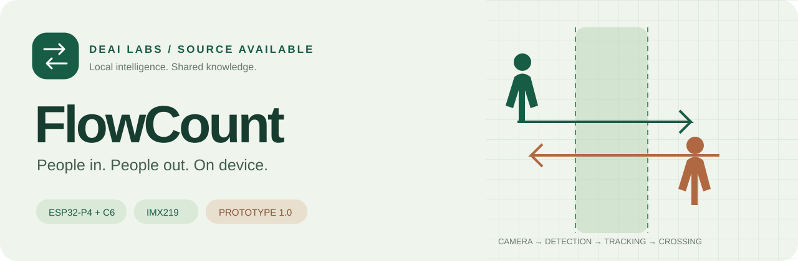
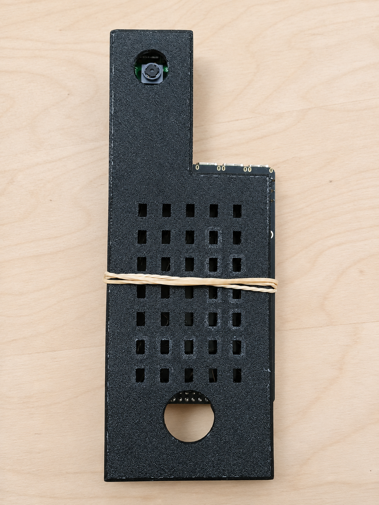
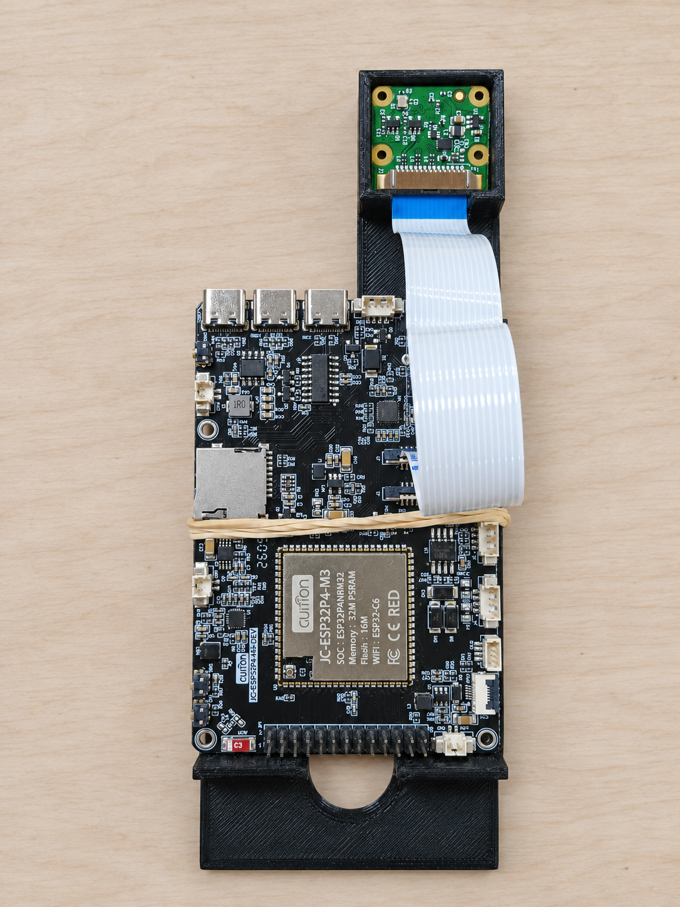
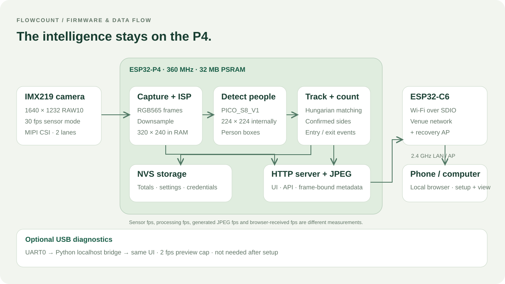
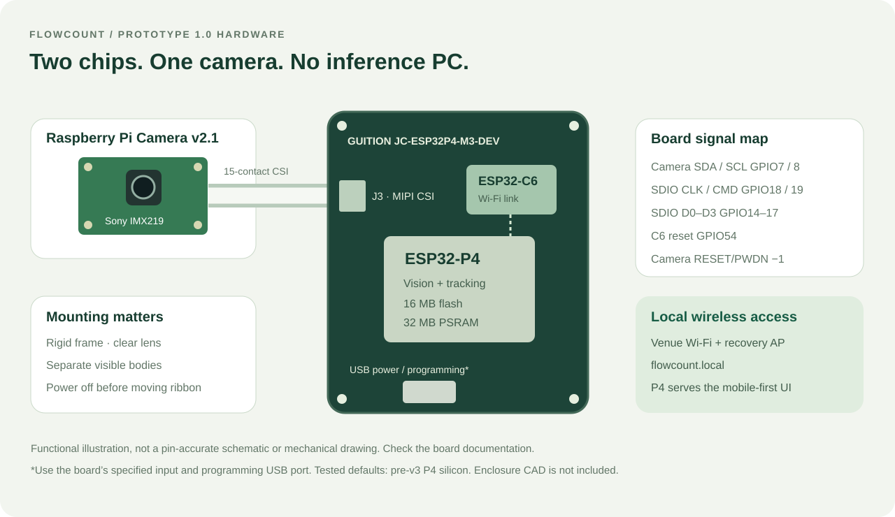
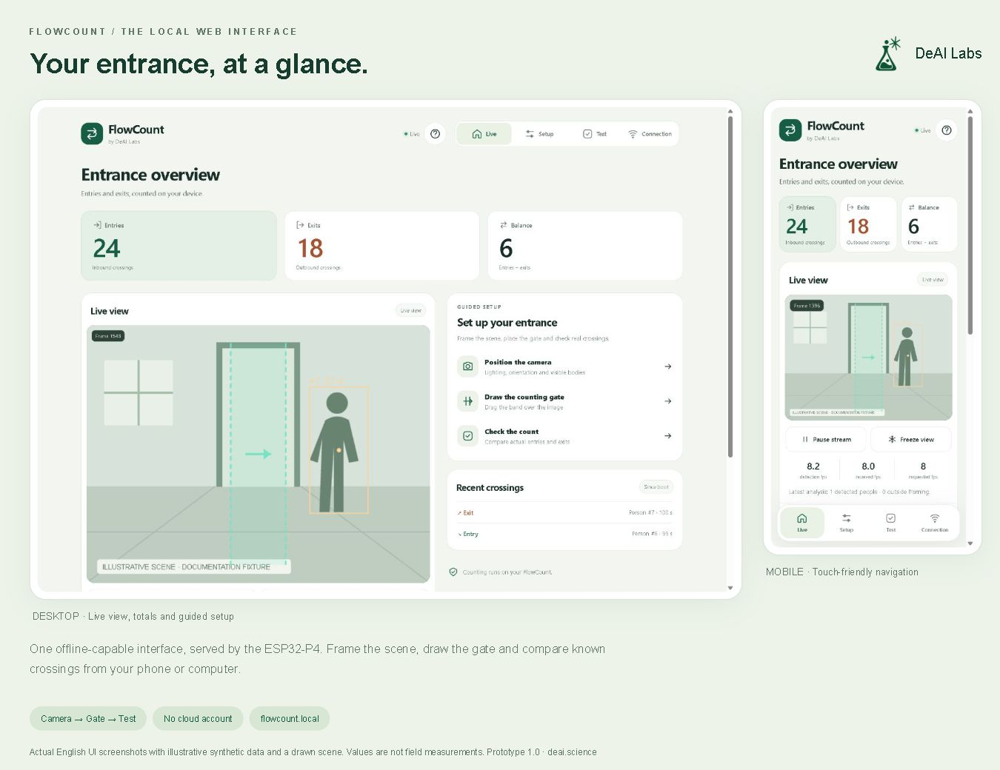
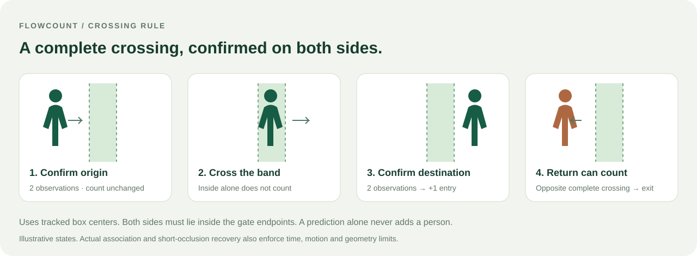

<p align="center"><a href="https://deai.science/"></a></p>

<p align="center">
  <a href="https://github.com/deai-science/flowcount/actions/workflows/ci.yml"></a>
  <a href="LICENSE"></a>
  
  
</p>

**Count entries and exits with a camera, a microcontroller and a browser.** FlowCount runs person detection, tracking, counting and a local web server on an ESP32-P4. An ESP32-C6 provides Wi-Fi. After setup, the prototype needs power; a phone or computer is only needed to view and configure it.

Built by **[DeAI Labs](https://deai.science/)** and shared so you can learn from the hardware, firmware, tests and decisions behind a real embedded vision project.

**Free for permitted noncommercial use. Commercial uses outside those permissions require a paid written license from DeAI Labs.** This is a source-available project. Read [the license guide](docs/LICENSING.md), [binding license](LICENSE) and [commercial route](COMMERCIAL_LICENSE.md).

**Start here:** [Hardware](#hardware) · [Build](#build-and-flash) · [Connect](#first-connection) · [Calibrate](#calibrate-at-the-actual-entrance) · [Code walkthrough](#learn-the-code) · [API](docs/API.md) · [Licensing](#license-and-commercial-use)

**Prototype status:** this is an experimental, working implementation. Crowds, occlusion and poor camera placement can cause missed or false counts. It has no validated general accuracy percentage. Evaluate it at your own entrance before relying on its totals. [Measurements and limitations →](docs/VALIDATION.md)

## Meet prototype 1.0

<table><tr>
<td width="50%"></td>
<td width="50%"></td>
</tr><tr><td>Camera and ventilated printed cover</td><td>Board, camera and CSI ribbon</td></tr></table>

These are **AI-retouched photographs of the supplied prototype**, edited for lighting and presentation. Fine details may differ. The [original photographs and editing notes](docs/MEDIA.md) are included for comparison. Use the hardware documentation for connections. Enclosure CAD/STL files are not included in this release.

## What you can build

- Bidirectional counting with a draggable gate and configurable entry direction.
- On-device pedestrian detection and multiple temporary tracks; no face recognition.
- A mobile-first dashboard with live boxes, totals, recent events and separate detection/preview fps.
- Guided **Camera → Gate → Test** calibration with explanations beside each control.
- Real sensor exposure and gain controls, image adjustments, preview rate and JPEG quality.
- Persistent settings and totals, venue Wi-Fi with automatic reconnection, and a recovery access point.
- A local HTTP API and optional USB monitor, without a cloud service or external inference computer.

The firmware does not record video to storage by default. Live images are accessible to clients on the configured local network. **MQTT and native Home Assistant discovery are roadmap items**, not implemented features.

## How it works



The IMX219 sends two-lane MIPI CSI video to the P4. `esp_video` and the ISP deliver RGB565 frames. The application downsamples them to **320 × 240**, and Espressif's `PedestrianDetect::PICO_S8_V1` uses an internal **224 × 224** input. A Hungarian assignment tracker associates boxes across frames. A complete crossing from one confirmed side of the gate to the other creates an entry or exit event.

Weak detections may continue an established track but cannot start a new one. Constrained recovery handles short occlusions. It cannot separate two people that the detector sees as a single box. [Firmware and algorithm →](docs/ARCHITECTURE.md)

## Hardware

| Part | Tested configuration |
| --- | --- |
| Board | **GUITION JC-ESP32P4-M3-DEV** |
| Main processor | ESP32-P4 revision 1.3, 360 MHz |
| Memory | 16 MB flash, 32 MB PSRAM |
| Camera | **Raspberry Pi Camera v2.1**, Sony IMX219 |
| Camera connection | J3, 15-contact CSI ribbon, two data lanes |
| Wireless | Onboard ESP32-C6 over SDIO; 2.4 GHz Wi-Fi |
| Power / setup | Suitable USB power supply and data cable |
| Mount | Rigid mount with an unobstructed camera view |



The defaults target the tested **P4 revision earlier than v3**. Check chip revision, memory and pins before using another board. Disconnect power before adjusting the ribbon. The tested C6 already runs compatible ESP-Hosted firmware (2.3.2); this repository builds and flashes the P4 only. [Pin map and assembly →](docs/HARDWARE.md)

## Build and flash

Install **ESP-IDF 5.5.5** with ESP32-P4 tools and open an activated ESP-IDF terminal:

```sh
git clone https://github.com/deai-science/flowcount.git
cd flowcount
idf.py build
idf.py -p COM5 -b 460800 flash
```

Replace `COM5` with your board's programming port (`/dev/ttyUSB0` is a common Linux example). Component Manager downloads the dependencies pinned in `main/idf_component.yml` and `dependencies.lock`. A generated `sdkconfig` is excluded; defaults are in `sdkconfig.defaults`.

On Windows, the helper finds `IDF_PATH` or `%USERPROFILE%\esp\esp-idf-v5.5.5`:

```powershell
.\tools\idf.ps1 build
.\tools\idf.ps1 -p COM5 -b 460800 flash
```

Normal `flash` **preserves NVS**, including saved Wi-Fi, calibration and totals. Do not use `erase-flash` for routine updates. `tools/flash.ps1` is a destructive recovery helper requiring a verified full backup. Do not flash the C6 as part of a P4 update.

If your user path contains spaces, give the ISP compiler a space-free cache:

```sh
idf.py -DPC_IPA_CACHE_DIR=C:/esp32-ipa-cache build
```

See [development and recovery](docs/DEVELOPMENT.md) for tests and backups.

## First connection

1. Connect USB and obtain private device access information:

   ```sh
   python tools/device_console.py --port COM5 --reset --access-file .private/network-access.json
   ```

   Use ESP-IDF Python, or install `requirements-dev.txt` for the monitor. Read `ap_password` from this local file. Stop with `Ctrl+C` before opening another tool on that serial port.

2. Join **`FlowCount-XXXXXX`** using that WPA2 key. Open **[http://192.168.4.1/](http://192.168.4.1/)**. The web login is **`admin` / `admin`**.
3. In **Connection**, scan for the venue's **2.4 GHz** network, select its exact name, enter the password, and choose **Save and connect**. Wait for **Connected** and an IP; “Saved” alone does not mean connected.
4. Rejoin the venue network and open **[http://flowcount.local/](http://flowcount.local/)**, or the IP shown in Connection. Both clients must share a LAN without client isolation.

After this, power alone is sufficient. The recovery AP stays available if the router changes. If `.local` does not resolve, use the IP; a router DHCP reservation can keep it stable. Give each device a unique hostname in code if installing several on one LAN.

The AP key is generated on first boot and saved in NVS, separately from web credentials. No real device key or venue password is included here. HTTP is unencrypted and web credentials are public defaults: use a trusted, isolated LAN and do not expose the device to the Internet. [Security model →](SECURITY.md)

**USB alternative:** run `python tools/monitor.py --port COM5`, then open `http://127.0.0.1:8765/` with `admin/admin`. Opening `tools/monitor.html` as `file://` does not connect it to the device.

## A UI that works from your phone



The screenshot uses the actual English UI with **illustrative data**, not a measured deployment. The device serves the same HTML offline; no CDN, app installation or cloud account is required.

## Calibrate at the actual entrance



1. **Camera:** mount it rigidly, uncover the lens and make each person's body visible before and after crossing. This is a pedestrian detector, not an overhead head detector.
2. **Gate:** choose vertical for left/right travel, or horizontal for up/down travel. Drag the band and endpoints; the green arrow is entry. Orange means an unsaved draft. Save the gate.
3. **Test:** start a test, perform known entries/exits, stop inside the band, and walk outside its endpoints. Compare with your manual count, then repeat with pairs, groups and normal lighting.

Camera controls preview changes in RAM. Select **Save camera** to persist them. Gate, confidence and body-filter settings save when applied. Pausing the stream or freezing your browser does not stop counting.

Start with confidence **0.55**. Lowering it can recover tracks and also admit false detections. Confidence is not counting accuracy. For blurred motion, try automatic exposure limited to 8–12 ms with adequate lighting. [Every control explained →](docs/CALIBRATION.md)

**Balance = entries − exits.** It represents occupancy only if the space started empty and all access routes are counted. Totals save every **5 minutes when changed**. Select **Save counters now** before disconnecting power; an abrupt cut may lose crossings since the last save.

## Real performance, with context

| Measurement | Observed bench result | Meaning |
| --- | --- | --- |
| Sensor mode | 30 fps | Sensor output, not inference throughput |
| P4 processing | 9.93 fps | Latest measured application processing rate |
| JPEG generation | 7.71 fps | Latest measured preview output generation |
| USB preview received | 11 valid JPEGs in about 6 s (1.78 fps) | UART path, capped at 2 fps |
| Requested Wi-Fi preview | Default 8 fps, configurable 1–12 | A target, not a measured result |

Rates vary with corrections, scene, network and clients. The UI measures **received browser fps separately**. The publication pass does not add a new physical crossing-accuracy trial. [Methods, replay results and remaining limits →](docs/VALIDATION.md)

## API and integrations

```sh
curl --user admin http://flowcount.local/state
```

`curl` asks for the web password. Read totals from `state.entries`, `state.exits` and `state.balance`. `/image.jpg` includes frame-matched metadata in `X-Frame-State`; commands and Wi-Fi configuration use authenticated JSON POSTs. Check HTTP status and JSON `ok`. [HTTP and UART reference →](docs/API.md)

A manually configured Home Assistant REST sensor can poll this API. MQTT delivery, persistent event queues and Home Assistant discovery are not present yet.

## Explore the source

| Path | What to learn |
| --- | --- |
| [`main/`](main/) | Camera/ISP, inference, NVS, HTTP and C6 networking |
| [`components/people_counter/`](components/people_counter/) | Portable C++ tracking and crossing logic |
| [`tools/monitor.html`](tools/monitor.html) | Self-contained mobile-first UI |
| [`tools/`](tools/) | USB bridge, diagnostics, replay and export |
| [`tests/`](tests/) | C++, Python and JavaScript regression tests |
| [`docs/`](docs/) | Hardware, architecture, calibration, API and validation |
| [`config/`](config/) | IMX219 ISP tuning and upstream license |

## Learn the code

The application is organized around one processing loop and a separate network
task. Start with `app_main()` in [`main/app_main.cpp`](main/app_main.cpp), then
follow these boundaries:

1. **Boot and restore.** Initialize NVS, validate versioned settings, restore
   saved totals, start networking and initialize the camera. A short warm-up
   lets automatic exposure and white balance settle before tracking.
2. **Capture.** `Camera::capture()` supplies the application-owned RGB565 image.
   [`main/camera.cpp`](main/camera.cpp) handles V4L2 buffers, DMA cache coherence,
   downsampling, orientation and supported sensor controls.
3. **Detect.** `model.run(img)` runs `PedestrianDetect` on the P4. The application
   converts pixel boxes into normalized coordinates and attaches scores.
4. **Filter.** `pc::detection_decision()` in
   [`main/detection_policy.hpp`](main/detection_policy.hpp) rejects invalid or
   excluded framing proposals and preserves strong/weak confidence information.
5. **Track and count.** `pc::Counter::update_scored(boxes, now)` associates
   detections with temporary tracks and returns confirmed crossing events.
   [`people_counter.cpp`](components/people_counter/people_counter.cpp) has no
   ESP-IDF dependency, so this logic can be tested on a computer.
6. **Publish and save.** Each event marks totals dirty and publishes UART/web
   telemetry. `report()` exposes current state; `send_jpeg()` generates preview
   images on their own schedule. Changed totals save every five minutes.

The core API can also be used with another detector. Here is a minimal example
of a **vertical gate**, with a box observed twice on each side. Coordinates are
fractions of the image; scores are detector confidence, not accuracy:

```cpp
#include "people_counter.hpp"

pc::Config config;
config.vertical = true;             // Movement along X.
config.positive_is_entry = true;    // Left to right is entry.
config.full_body_only = true;
pc::Counter counter(config);

counter.update_scored({{{0.20f, 0.10f, 0.40f, 0.90f}, 0.90f}}, 0);
counter.update_scored({{{0.22f, 0.10f, 0.42f, 0.90f}, 0.90f}}, 100);
counter.update_scored({{{0.35f, 0.10f, 0.55f, 0.90f}, 0.90f}}, 200);
counter.update_scored({{{0.45f, 0.10f, 0.65f, 0.90f}, 0.90f}}, 300);
counter.update_scored({{{0.58f, 0.10f, 0.78f, 0.90f}, 0.90f}}, 400);
auto events = counter.update_scored(
    {{{0.60f, 0.10f, 0.80f, 0.90f}, 0.90f}}, 500);
// A continuous confirmed crossing can emit one entry event.
```

For a real sequence, association also checks distance, overlap, timing and
geometry. The synthetic example is intentionally small; the regression suite
exercises reversals, ROI exclusion, weak proposals, dropped observations and
occlusion. See [architecture](docs/ARCHITECTURE.md) for the complete rules.

Networking is implemented in [`main/device_web.cpp`](main/device_web.cpp):
`device_web_start()` creates a task for C6 connectivity and HTTP, while snapshot
publication and the command queue connect it to the main loop. The browser
never runs the detector. [`tools/monitor.html`](tools/monitor.html) draws exact
frame-bound boxes, keeps draft settings separate from saved settings, and polls
state and images independently. It is embedded at build time by
[`main/CMakeLists.txt`](main/CMakeLists.txt).

**Where to make a change:**

| Goal | Start here | Relevant check |
| --- | --- | --- |
| Counting or identity behavior | `components/people_counter/` | `tests/counter_test.cpp` |
| Proposal filtering | `main/detection_policy.hpp` | `tests/detection_policy_test.cpp` |
| Camera controls and validation | `main/camera.cpp`, `main/camera_settings.hpp` | `tests/camera_settings_test.cpp` and hardware build |
| Reconnection timing | `main/network_policy.hpp` | `tests/network_policy_test.cpp` |
| HTTP/UART bridge | `main/device_web.cpp`, `tools/monitor.py` | `tests/test_monitor.py`, device API checker |
| UI guidance, drafts and trial display | `tools/monitor.html` | `tests/test_ui.js`, responsive browser review |

Rebuild and flash the P4 after changing embedded UI or firmware. Preserve NVS
for routine updates. A camera or placement change requires fresh calibration,
not just passing a host test.

## Contribute

Start with [CONTRIBUTING.md](CONTRIBUTING.md). Good contributions include reproducible missed-count reports, synthetic tracking cases, camera placement studies and hardware support. Use consented data and never attach credentials or raw flash backups.

```sh
python -m pip install -r requirements-dev.txt
python -m unittest discover -s tests -p "test_*.py" -v
node tests/test_ui.js
cmake -S tests -B tools/host-build -DCMAKE_BUILD_TYPE=Debug
cmake --build tools/host-build --config Debug
ctest --test-dir tools/host-build -C Debug --output-on-failure
```

## Roadmap

- Field validation with labelled, consented sequences and repeatable error metrics.
- Better handling of overlapping people and multi-device deployment.
- Configurable web authentication and a stronger deployment security model.
- MQTT totals/events, availability and optional Home Assistant discovery.
- Enclosure CAD and assembly improvements when source files are available.

## License and commercial use

Original FlowCount software and documentation use the **[PolyForm Noncommercial License 1.0.0](LICENSE)**, with a **separate paid commercial licensing route** from DeAI Labs.

| Intended use | License route |
| --- | --- |
| Personal learning, hobby projects and other permitted noncommercial uses | Free under LICENSE |
| Uses by eligible educational, charitable, public research and other organizations expressly covered by the standard license | Permitted under LICENSE; see its organizational provision |
| Commercial uses outside those permissions: selling devices, paid integrations/services or ordinary business production deployment | Obtain a paid written agreement from DeAI Labs before use |

Read [docs/LICENSING.md](docs/LICENSING.md) for exact scope and [COMMERCIAL_LICENSE.md](COMMERCIAL_LICENSE.md) to request an agreement. The repository sets no automatic fee or revenue percentage. It is **source-available, not OSI open source**; publishing a commercial derivative's code does not automatically replace the need for an applicable license.

Third-party components and models retain their licenses; see [THIRD_PARTY_NOTICES.md](THIRD_PARTY_NOTICES.md). Keep [NOTICE](NOTICE) when distributing copies. DeAI Labs names/logos remain trademarks of their owner and do not imply endorsement of forks. Media provenance and permissions are in [docs/MEDIA.md](docs/MEDIA.md).

Built on the work of Espressif, the IMX219 community driver maintainers and the open-source embedded community. [Sources →](docs/SOURCES.md) · [DeAI Labs →](https://deai.science/)
