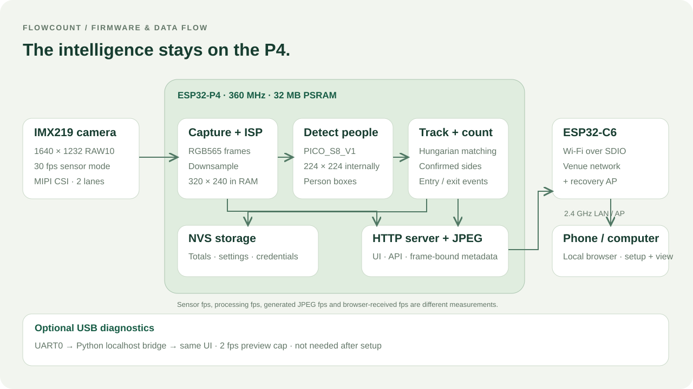
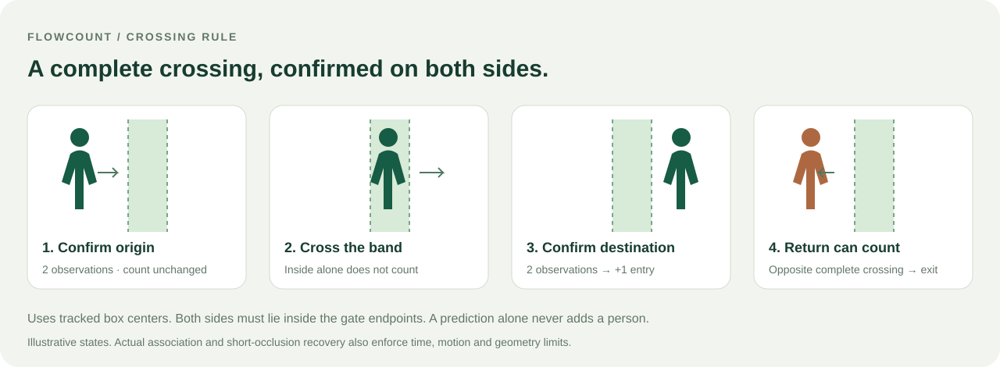

# Architecture and counting logic

## Module responsibilities

| Module | Responsibility |
| --- | --- |
| `main/app_main.cpp` | Boot, detector, application loop, commands and counter NVS |
| `main/camera.cpp` | CSI/ISP, V4L2 capture, RGB565 downsampling and sensor controls |
| `components/people_counter/` | Portable C++ association, track state and crossing events |
| `main/detection_policy.hpp` | Strong/weak proposal selection and geometric filtering |
| `main/device_web.cpp` | C6 Wi-Fi, mDNS, HTTP authentication, snapshots and command queue |
| `main/network_policy.hpp` | Testable connection retry timing |
| `components/captive_dns/` | DNS for the recovery access-point portal |
| `tools/monitor.html` | Shared offline-capable browser UI, embedded during build |
| `tools/monitor.py` | Optional UART-to-localhost bridge |

## Capture and inference

The tested IMX219 mode is **1640 × 1232 RAW10 at 30 sensor fps**. `esp_video` configures CSI and ISP, supplying RGB565 through V4L2 with two capture buffers. The application synchronizes DMA caches, copies/downsamples into its own **320 × 240 PSRAM buffer**, then returns the capture buffer.

Precomputed row/column maps avoid per-pixel division. Mirror/flip happen after Bayer processing. Brightness, contrast and saturation corrections affect both detector and JPEG input; neutral settings avoid that extra work. JPEG quality affects only preview compression.

Exposure/gain use V4L2 extended-control discovery, get/set and the sensor gain table. Automatic mode uses ISP AGC with an exposure ceiling. Returning from manual restores the values expected by the pipeline's control cache before handing control back. White balance stays automatic; Camera v2.1 has no software-driven autofocus motor here.

`PedestrianDetect::PICO_S8_V1` adapts the image to its internal **224 × 224** input. NMS threshold is 0.50 and proposals are requested from score 0.30. The configurable start threshold defaults to 0.55. Coordinates are normalized `[x1,y1,x2,y2]`; crossings use **box centers**, not foot points or identity recognition.

## Strong and weak association

The tracker first assigns strong proposals through a Hungarian cost matrix using center distance, IoU and motion prediction. It can also use distance to the last observed center with a 0.03 penalty, preventing a changed torso/body box from forcing an implausible prediction jump.

A weak proposal can continue an existing identity only with recent strong evidence (within 1200 ms) and compatible size (area ratio 0.35–2.8). Ordinary continuation requires IoU above 0.10 and two prior observations. A second observation after the initial strong detection may be weak within 200 ms if IoU exceeds 0.25. Occlusion recovery uses a stricter predicted-position test. **Weak proposals never create new identities.**

| Internal setting | Value | Meaning |
| --- | --- | --- |
| `max_tracks` | 24 | Maximum retained tracks |
| `max_distance` | 0.20 | Normalized association distance |
| `confirm_frames` | 2 | Observations required to confirm a side |
| `expire_ms` | 1200 ms | Track removal after no detection |
| `max_crossing_gap_ms` | 400 ms | Ordinary origin continuity limit |
| `max_occlusion_gap_ms` | 900 ms | Conditional in-band occlusion recovery |

The detector returns at most 10 proposals per frame. A 24-track capacity does not mean reliable counting of 24 simultaneous people.

## Geometric filters

With `full_body_only` enabled, boxes touching the top 1% and bottom 2% simultaneously are excluded before association. Touching one edge is allowed. The compatibility field name does not mean head/foot or pose validation. Excluded boxes are shown separately as `ignored_detections`.

`covers_image` always rejects boxes reaching **all four edges within 1.5%**, even if the optional body filter is off. This targets high-confidence whole-image false positives observed with an obstructed view. It is a heuristic; other false positives remain possible.

## Crossing state machine

For a vertical band use center X; for horizontal use center Y. Values below `line-band` are the negative side, inside the band are neutral, and above `line+band` are positive.

1. Two same-side observations outside the band establish an origin.
2. Observations inside the band do not count. A sampled in-band frame is not mandatory for an ordinary continuous crossing.
3. Two observations confirm the opposite side; a track needs at least three detections overall.
4. A confirmed side change emits entry/exit according to the configured positive direction.
5. The new side becomes the origin for a return crossing.

Leaving the lateral ROI clears the origin. Beyond 400 ms, recovery up to 900 ms is allowed only if the track had a confirmed origin, was observed progressing inside the band, and reappears within normalized distance 0.10 of the prediction with compatible geometry. If both boxes touch the same image edge, area may shrink to 20% because of cropping. Destination still needs two observations. Band/opposite observations interrupt pending same-side confirmation.

IDs are temporary track labels. A return can count again, standing in the band cannot, and predictions alone do not generate events.

## Persistence and command ownership

NVS stores versioned counter settings/totals, a separate camera block, and network credentials. Crossings mark totals dirty; changed totals save every five minutes. `save` persists immediately. Gate/score/body changes discard active tracks and save while preserving totals; `reset` clears totals and tracks, then persists.

Camera edits preview in RAM until `camera save`. Restore/default commands may change orientation and clear tracks but preserve totals. Counter migration preserves old totals/settings and enables the newer filter when loading version 1. Routine flashing does not erase NVS.

The web keeps only 25 recent events in RAM. It is not a durable event log or MQTT queue. Reboot loses tracks, events and crossings since the last save.

HTTP counting commands enter a queue and execute on the main application task, with an approximately 2.5-second acknowledgement bound. The HTTP task does not mutate the model/tracker directly. UART and network diagnostics are separate from the counting loop.

## Connectivity

P4 runs all application work; C6 runs connectivity over ESP-Hosted SDIO. AP+STA preserves the recovery network alongside venue Wi-Fi. A 16-hex-character AP key is generated at first boot and retained in NVS. The default web login is independently `admin/admin`.

The AP is `FlowCount-XXXXXX`; the hostname is `flowcount`, advertised as `flowcount.local`. Multiple devices on one LAN need distinct hostnames. Credentials save atomically as a combined SSID/password block before a requested network change; password queries are not exposed.

Connection attempts time out after 20 seconds, with 1/2/4/8/16/up-to-30-second backoff. Link/IP are checked every five seconds; three failed checks trigger reassociation. Wi-Fi and HTTP startup failures retry. Network recovery does not reset the counter or erase NVS.

Asynchronous scans pause new association attempts, sort by signal, remove duplicate SSIDs and time out after 15 seconds. Results travel separately from frame metadata.

## Preview and UI consistency

JPEG generation targets 1–12 fps (default 8, quality 60) while inference continues. Image bytes, frame ID and metadata publish together. `/image.jpg` supplies exact `X-Frame-State` metadata; the UI never draws boxes from a newer, unrelated frame. `?after=N` returns 204 for the current image, avoiding repeated transfers. Browser state and image polling run separately without accumulating image requests.

The UI distinguishes processing fps, generated preview fps and received browser fps. Sensor fps is a fourth, separate quantity. UART preview is limited to 2 fps, uses CRC32 and a 15-second lease renewed every five seconds. Closing the monitor stops the lease so Wi-Fi preview does not depend on continuous UART video.

`boot_id` lets the browser discard stale drafts/trial baselines after a real reboot. Network interruptions alone do not reset a trial. Image-health heuristics sample 1200 RGB565 pixels for darkness, flatness and clipping; they warn but do not block counting.
