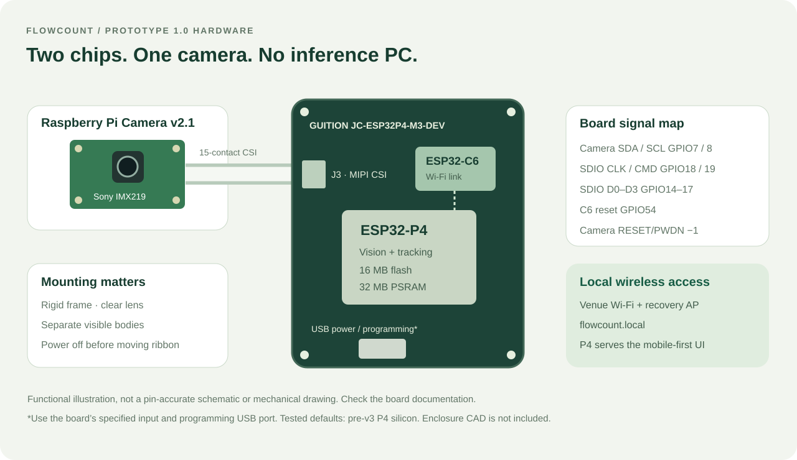

# Hardware and assembly

## Tested bill of materials

| Quantity | Part | Notes |
| --- | --- | --- |
| 1 | GUITION JC-ESP32P4-M3-DEV | Tested P4 revision 1.3; 16 MB flash / 32 MB PSRAM |
| 1 | Raspberry Pi Camera v2.1 | Sony IMX219; this is not an OV5647 or IMX708 |
| 1 | Compatible 15-contact CSI ribbon | Check connector pitch, contact orientation and latch |
| 1 | USB power supply and cable | Use the board's specified power input and a reliable supply |
| 1 | USB data cable | Needed for first flash and UART diagnostics |
| 1 | Rigid camera/board mount | Prototype uses a printed frame and ventilated cover |

Photographs document prototype 1.0. The enclosure's CAD/STL and manufacturing files were not supplied and are not in this repository. This is a firmware project using an existing development board, not a complete open board design.

## Connection map

| Signal | Tested board assignment |
| --- | --- |
| Camera video | J3 CSI, two MIPI data lanes |
| Camera control SDA | P4 GPIO7 |
| Camera control SCL | P4 GPIO8 |
| Camera RESET / PWDN | No dedicated application GPIO (`-1`) |
| C6 SDIO CLK / CMD | GPIO18 / GPIO19 |
| C6 SDIO D0 / D1 / D2 / D3 | GPIO14 / GPIO15 / GPIO16 / GPIO17 |
| C6 reset | GPIO54 |
| Console | UART0, 921600 baud, board USB-to-UART programming connection |

These signals are board connections, not a request to jumper them externally. The camera ribbon carries CSI and camera control/power through the board connector. Verify the [board schematic and driver references](SOURCES.md) for the exact board revision. The diagram is a functional map, not a pin-accurate schematic.

## Assembly sequence

1. Disconnect all power. Open the CSI latch gently and check the connector's contact side against the board documentation.
2. Insert the compatible ribbon straight, fully seated, then close the latch. Do not guess orientation from an AI-retouched photo.
3. Secure the camera so the ribbon is not under tension or sharply creased. Keep the lens clear of the enclosure, rails and glass.
4. Use the programming USB connection for flashing and diagnostics. Keep other serial tools closed while flashing.
5. Check that the image is sharp, correctly oriented and well lit before calibrating the gate.

Do not connect or reposition the CSI cable while powered. This release expects a compatible C6 ESP-Hosted firmware already present. The development unit reports C6 firmware 2.3.2. It contains no C6 image or routine C6 flashing procedure.

## Camera placement

The model detects visible pedestrian bodies. Mount at an oblique or frontal view with enough distance to see separate people on both sides of the band. A ceiling-down head-only view requires a different detector. Position the band before people become hidden by furniture or leave the image.

Avoid backlighting, motion blur, railings and reflective surfaces. In crowds, one large box may contain multiple people; no gate setting can recover a person that the model never separates. Fix the framing first, then tune exposure/confidence.

## Porting

Review `sdkconfig.defaults`, `main/Kconfig.projbuild`, the SDIO configuration and `main/camera.cpp`. Defaults select pre-v3 P4 silicon, hex PSRAM and the tested memory layout. Do not assume these match every ESP32-P4 board. `PC_BOARD_PINS_CONFIRMED` is enabled for the tested board; disable it until you verify an unfamiliar pinout.
